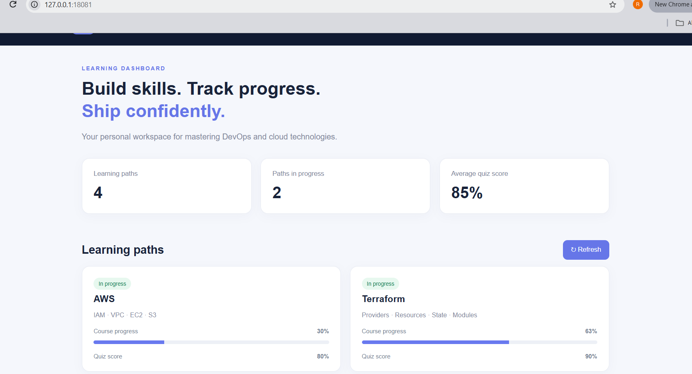
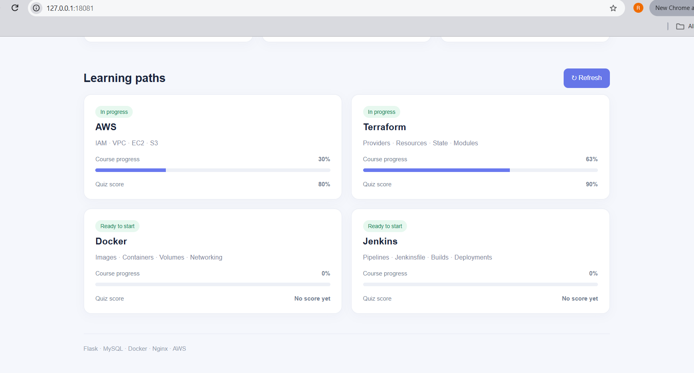
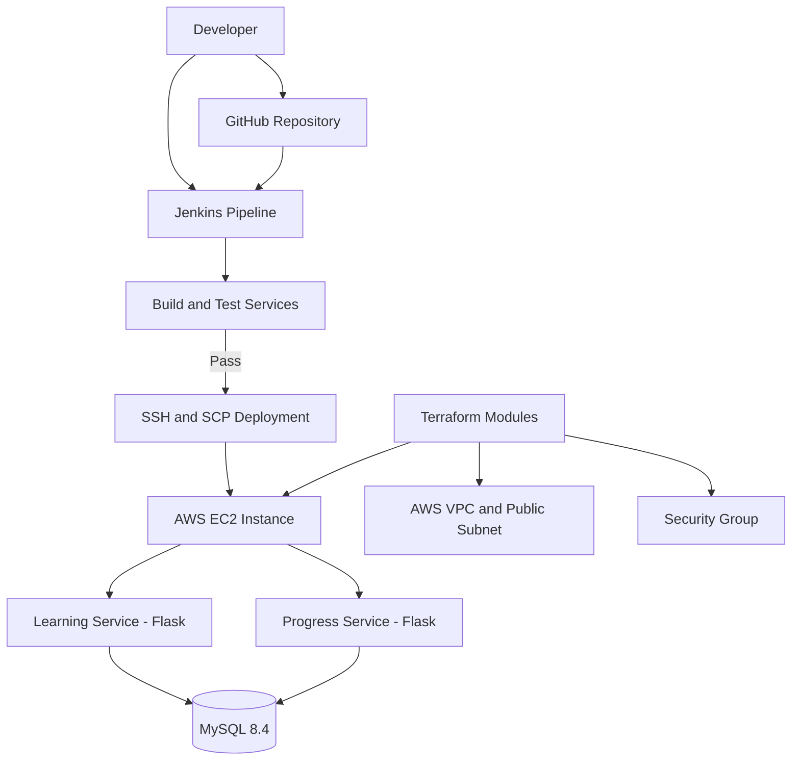

# AWS Terraform Microservices — DevOps Learning Portal

A hands-on DevOps portfolio project that combines Python microservices,
Docker Compose, MySQL, Jenkins CI/CD, Terraform, and AWS EC2.

The project demonstrates containerization, automated testing, infrastructure
as code, deployment automation, service health checks, and troubleshooting.

## Project Overview

The DevOps Learning Portal provides learning-path and progress APIs for
topics such as AWS, Terraform, Docker, and Jenkins.

## Application Screenshots

### DevOps Learning Portal Dashboard



### Learning Progress and Course Details



### Technology Stack

| Area | Technology |
|---|---|
| Application APIs | Python, Flask |
| Database | MySQL 8.4 |
| Containers | Docker, Docker Compose |
| CI/CD | Jenkins |
| Cloud | AWS EC2, VPC, Subnet, Internet Gateway |
| Infrastructure as Code | Terraform |
| Operating environment | Ubuntu 24.04, WSL2 for local development |
| Source control | Git, GitHub |

## Architecture



The application services are configured to bind to EC2 loopback interfaces.
The Jenkins deployment connects over SSH. Application API access from a
developer machine can be tested through an SSH tunnel.

## Repository Structure

```text
.
├── Jenkinsfile
├── docker-compose.yml
├── .gitignore
├── db/
│   └── init/
│       └── 01-schema.sql
├── learning-service/
│   ├── Dockerfile
│   ├── app.py
│   ├── requirements.txt
│   └── tests/
├── progress-service/
│   ├── Dockerfile
│   ├── app.py
│   ├── requirements.txt
│   └── tests/
├── mysql/
│   └── conf/
│       └── low-memory.cnf
└── terraform/
    ├── environments/
    │   └── dev/
    └── modules/
        ├── ec2/
        ├── security-group/
        └── vpc/
```

## Application APIs

| Service | Endpoint | Purpose |
|---|---|---|
| Learning | `/health` | Service health check |
| Learning | `/api/learning-paths` | Retrieve learning paths |
| Progress | `/health` | Service health check |
| Progress | `/api/progress` | Retrieve learning progress |

The progress API also validates submitted progress data. Invalid values
are expected to return HTTP 400 where applicable.

Default local service ports used by the project are 5001 for the learning
service and 5002 for the progress service.

## Run Locally

Prerequisites:
- Docker Engine
- Docker Compose
- Git

Clone the repository:

```bash
git clone https://github.com/rakeshnm27-bot/aws-terraform-microservices.git
cd aws-terraform-microservices
```

Create a local `.env` file using the environment variables required by
`docker-compose.yml` and the application configuration. Set strong local
credentials. Do not commit `.env`.

Build and start the services:

```bash
docker compose up -d --build
docker compose ps
docker compose logs --tail 100
```

Check the configured health endpoints:

```bash
curl http://127.0.0.1:5001/health
curl http://127.0.0.1:5002/health
```

Expected health response:

```json
{"status":"UP"}
```

To stop the services without deleting persistent database volumes:

```bash
docker compose down
```

**Do not use `docker compose down -v` unless you intentionally want to
delete the Compose-managed volumes and understand the data-loss risk.**

## Jenkins CI/CD

The `Jenkinsfile` defines a pipeline that:

1. Builds the learning-service image.
2. Runs learning-service tests.
3. Builds the progress-service image.
4. Runs progress-service tests.
5. Prepares deployment images for transfer.
6. Connects to EC2 using an SSH credential.
7. Transfers and loads the images on EC2.
8. Updates the application containers with Docker Compose.
9. Retries application health checks and reports the deployment result.

Configure the Jenkins SSH credential with ID `aws-ec2-ssh`. Store the
private key in Jenkins Credentials; never put it in the repository.

The current Jenkinsfile uses a configured EC2 public IP. Update the
`EC2_HOST` value if the instance public IP changes. A stopped and restarted
EC2 instance may receive a different public IP unless an Elastic IP is used.

The pipeline has been run successfully with build, test, deployment, and
health-check stages passing. Automatic triggering on every Git push should
only be claimed when the webhook or another trigger is configured and
verified.

## Terraform Infrastructure

Terraform source is organized into reusable modules.

### VPC module
- Creates a VPC with configurable CIDR.
- Creates a public subnet.
- Creates an Internet Gateway.
- Creates and associates a public route table.

### Security group module
- Allows SSH from the configured `ssh_cidr`.
- Allows outbound traffic.
- Does not add public inbound application-port rules.

### EC2 module
- Selects an Ubuntu 24.04 AMI.
- Supports a configurable instance type and EC2 key pair.
- Configures an encrypted 8 GB gp3 root volume.
- Requires IMDSv2 tokens.

The development environment uses the AWS region `ap-south-1` by default.
The provider configuration references the AWS CLI profile `terraform-lab`.

### Terraform prerequisites

Install Terraform and configure AWS CLI credentials locally. Ensure the
selected AWS identity has the permissions required for the resources.

From the repository root:

```bash
cd terraform/environments/dev
terraform init
terraform fmt -check -recursive ../../
terraform validate
terraform plan
```

Review the plan before considering any infrastructure changes. Use the
required input values for `ssh_cidr` (your public IP in CIDR notation,
typically `/32`) and `key_name` (an existing EC2 key pair).

Do not run `terraform apply` against an existing environment until you have
confirmed which resources the configuration and state would create, change,
or destroy. Keep Terraform state files, local variable files, and generated
plans out of Git.

## Security Practices

- Keep `.env`, credentials, private keys, database backups, Terraform state,
  and generated plan files out of GitHub.
- Restrict SSH access to a trusted public IP instead of `0.0.0.0/0`.
- Keep application ports private unless a reviewed access design requires
  otherwise.
- Use Jenkins Credentials for SSH authentication.
- Review Terraform plans before applying infrastructure changes.
- Avoid committing database dumps or files containing real user data.

## Cost Management

This project uses AWS resources that may incur charges. Check current AWS
pricing for the selected region and instance/storage configuration.

Stop the EC2 instance when it is not needed, and inspect other billable
resources before leaving the lab idle. Stopping an instance does not
necessarily eliminate charges for attached storage or other resources.

## Validation and Troubleshooting

Useful commands:

```bash
docker compose ps
docker compose logs --tail 100
docker inspect portal-mysql
terraform fmt -check -recursive terraform
terraform -chdir=terraform/environments/dev validate
git status
```

For deployment failures, check Jenkins console output, SSH connectivity,
EC2 Docker status, container logs, and application health endpoints.

## Learning Outcomes

- Containerized Flask microservices.
- Integrated a MySQL database with Docker Compose.
- Wrote automated application tests.
- Built a Jenkins pipeline for image build, testing, and deployment.
- Provisioned AWS networking and compute resources using reusable
  Terraform modules.
- Practiced SSH security, health checks, cost awareness, and troubleshooting.

## Future Improvements

- Store Terraform state in a secured remote backend with state locking.
- Replace hardcoded deployment host configuration with managed parameters.
- Add a controlled GitHub webhook trigger and verify end-to-end triggering.
- Add application monitoring, structured logging, and alerting.
- Introduce a more secure deployment identity and automated infrastructure
  checks in CI.

### Example Terraform variables

A placeholder example is provided at
`terraform/environments/dev/terraform.tfvars.example`.

Create your local variables file from the example:

```bash
cd terraform/environments/dev
cp terraform.tfvars.example terraform.tfvars
```

Edit `terraform.tfvars` and replace `YOUR_PUBLIC_IP/32` with your trusted
public IP in CIDR notation and `YOUR_EXISTING_EC2_KEY_PAIR_NAME` with the
name of an existing EC2 key pair.

The real `terraform.tfvars` file is ignored by Git. Never commit actual
credentials, private keys, Terraform state, or generated plan files.

Initialize and validate the configuration:

```bash
terraform init
terraform validate
terraform plan
```

Review the plan carefully before making any infrastructure changes.
